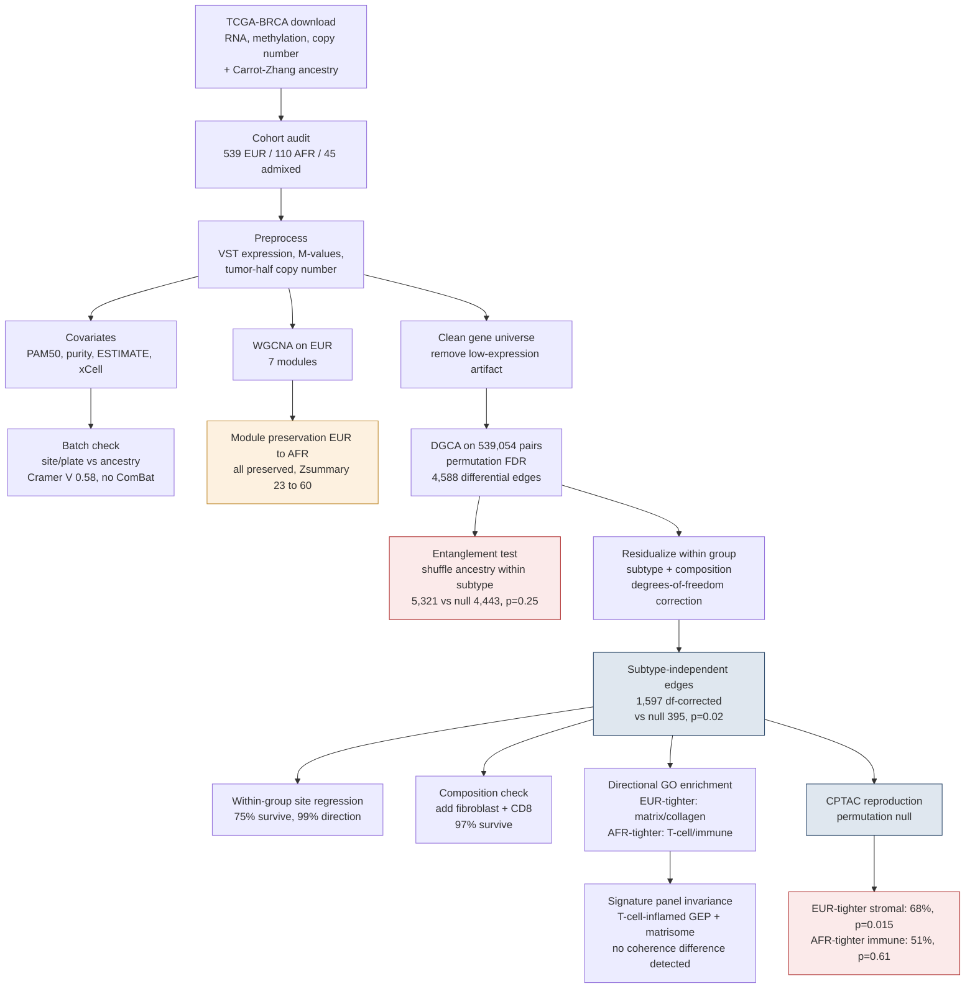

# Analysis architecture

This is the full flow of the analysis, from raw data to the findings in the paper.
Each stage reads files written by an earlier stage and writes its own outputs, so
stages can be run one at a time.

## Reading the diagram

The two red boxes are the results that shape the paper. The entanglement test
shows that ancestry does not produce more differential edges than subtype alone.
The CPTAC reproduction shows that the stromal edges hold up in an independent
cohort while the immune edges do not.

The blue boxes are the subtype-independent set and its reproduction. The amber
box is the module-level negative result that frames the rest of the work.
